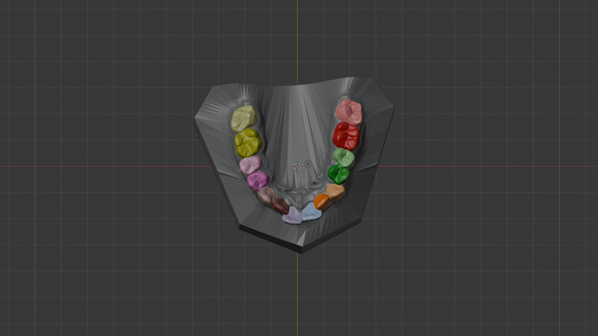
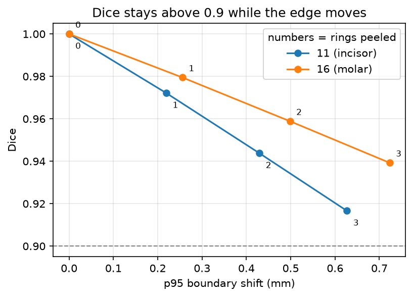

# teeth3ds-boundary-eval

Measuring tooth–gum boundary error in mm on Teeth3DS+ intraoral scans, where overlap scores like Dice hide it.



Scan 01F4JV8X (upper) from [Teeth3DS+](https://osf.io/xctdy), Ben-Hamadou et al., [CC BY-NC-ND 4.0](https://creativecommons.org/licenses/by-nc-nd/4.0/), rendered with tooth labels as colours.

**Status:** loader and statistics over all 1,800 labelled scans. Phase 1 is done on one scan (an incisor and a molar): Dice compared with boundary error in mm. Phase 2, a small segmentation model, is next.

## Why

Segmentation is usually scored by an overlap score like Dice or F1. Scores depend on how much of the predicted tooth overlaps the true tooth. A prediction can overlap almost perfectly while its edges will sit a fraction of a millimetre off all the way round, so the score looks excellent while the boundary is incorrect. The edge matters significantly in dentistry, for example where a crown's margin sits. This project measures boundary error directly, in mm, and shows how far it can drift before overlap scores are impacted.

## Results so far

### Phase 1: Dice hides boundary error

**At three peeled rings, Dice is still above 0.9 for both teeth, while the edge has moved 0.63 mm (incisor) and 0.72 mm (molar) at the 95th percentile. Dice also ranks the molar higher at every step, even though its edge moves even more.** Larger teeth have a smaller share of their vertices on the edge (4.0% for the molar against 5.4% for the incisor), so the same edge error has even less impact on Dice score.

<!-- TODO: add the plot once made

-->

For scan `01F4JV8X_upper`. Shift is the distance from each predicted boundary vertex (due to artificial peeling of boundary vertices) to the nearest true boundary vertex, in mm.

| Tooth | Rings peeled | Vertices left | Dice | Median shift | p95 shift | Max shift |
| --- | --- | --- | --- | --- | --- | --- |
| 11 (incisor) | 0 | 6,011 | 1.000 | 0.000 | 0.000 | 0.000 |
| 11 (incisor) | 1 | 5,685 | 0.972 | 0.111 | 0.219 | 0.321 |
| 11 (incisor) | 2 | 5,371 | 0.944 | 0.263 | 0.429 | 0.564 |
| 11 (incisor) | 3 | 5,086 | 0.917 | 0.435 | 0.627 | 0.823 |
| 16 (molar) | 0 | 8,629 | 1.000 | 0.000 | 0.000 | 0.000 |
| 16 (molar) | 1 | 8,282 | 0.979 | 0.121 | 0.256 | 0.483 |
| 16 (molar) | 2 | 7,947 | 0.959 | 0.286 | 0.498 | 0.717 |
| 16 (molar) | 3 | 7,641 | 0.939 | 0.466 | 0.723 | 1.026 |

**Method:** start from the true labels and peel 1, 2 and 3 rings of boundary vertices off one tooth, relabelling them as gum (erosion on the mesh, which simulates a prediction error). The prediction is then perfect except at the edge. For each peel, compute that tooth's Dice and the boundary shift (median, p95, max) with a k-d tree nearest-neighbour search.

**Checks:**
- The 0-ring row needs to give Dice 1.0 and zero shift.
- Peeling only removes vertices, so Dice = 2·|pred| / (|true| + |pred|). I verified every row matches this by hand calculation, e.g. 2·5,685 / (6,011 + 5,685) = 0.972.

### Dataset (Phase 0)

| Measure | Value |
| --- | --- |
| Scans found / labelled | 1,900 OBJ files; 1,800 with labels (100 unlabelled scans skipped and logged) |
| Scans passing all load checks | 1,800 of 1,800 |
| Vertices per scan | 13,034 to 259,938 (median 114,560) |
| Median edge length per scan | 0.171 mm typical (middle half 0.165 to 0.202 mm; range 0.138 to 0.419 mm) |
| Coarse group | 68 scans (about 4%) at about 0.4 mm spacing and about 20,000 vertices |
| Teeth per scan | 8 to 16 (median 14) |
| Label codes present | 0 (gum) and adult FDI codes 11–18, 21–28, 31–38, 41–48; no primary-tooth codes (5x–8x) |
| Orphan vertices | 0 in every scan |
| Units | mm (arch widths 56 to 103 mm) |

A mesh can only place a boundary to about one edge length. So boundary errors are meaningful down to about the median, 0.17 mm, on a typical scan, but only about 0.4 mm on the coarser group. Results should be reported separately for the two groups.

The mesh appears to be densest where it matters. At the tooth 11 edge the spacing is about 0.11 mm, finer than the scan-wide median. The longest edges appear to be in the filled-in palate and base which has a visibily coarser appearance.

## Reproduce

```bash
# 1. Environment
conda env create -f environment.yml
conda activate teeth3ds-boundary-eval

environment.lock.yml is the exact Linux environment the results were produced with.

# 2. Data (not included in this repo, see "Data and licence")
#    Download data_part_1.zip to data_part_7.zip from the Teeth3DS+ OSF project
#    (https://osf.io/xctdy) and extract them all into one folder:
for f in data_part_*.zip; do unzip -q "$f" -d data/teeth3ds_full; done

# 3. Load and verify one scan
python src/load_scan.py data/teeth3ds_full/upper/01F4JV8X/01F4JV8X_upper.obj

# 4. Per-scan statistics for the whole dataset
python src/dataset_stats.py data/teeth3ds_full --out results/scan_stats.csv

# 5. Colour a scan by tooth label (writes a PLY to view in Blender)
python src/viz.py data/teeth3ds_full/upper/01F4JV8X/01F4JV8X_upper.obj --out results/01F4JV8X_upper_labels.ply

# 6. Phase 1: peel 0 to 3 rings off a tooth, writes results/boundary_stats_<tooth>.csv
python src/boundary.py data/teeth3ds_full/upper/01F4JV8X/01F4JV8X_upper.obj --tooth 11
python src/boundary.py data/teeth3ds_full/upper/01F4JV8X/01F4JV8X_upper.obj --tooth 16
```

## Design choices

- **Labels are matched to vertices by position**, so meshes are loaded with `process=False` (no vertex merging or reordering). An independent parse of the OBJ's vertex lines is compared with the loaded mesh to prove that no reordering occured.
- **Every scan is verified on load:**
  - vertex, label and instance counts need agree
  - vertex order is unchanged
  - face indices are in range
  - every label is gum or an adult FDI code, Teeth3DS+ has only adult teeth codes
  - patient ID and jaw match the filename.
- **Failure scans are recorded.** Each check raises a clear `ValueError` or `FileNotFoundError`. Batch runs log and skip only those expected bad-scan errors; anything else is a code bug and stops the run with a traceback.
- **Boundary error is reported in mm** (median, p95, max), not in rings or vertices. This is due to mesh density varying across a jaw and between scans, so I measure the shift as a nearest-neighbour distance in mm instead of counting rings.
- **Every result has a known answer to check against.** I check and compare the 0-ring row and the hand-computed Dice.
- **One fixed colour per tooth code** A tooth has the same colour in every figure.

## Limitations

- **Phase 1 is one scan and two teeth.** It shows the effect. This doesn't yet measure how large it is across the dataset.
- **Peeling is a synthetic error:** a uniform inward shift. A real model's errors are going to be patchy. This is for future phases of the project.
- **These are mostly natural teeth, not prepared ones.** A crown margin would sit on a prepared tooth, so the tooth–gum boundary here is a proxy.
- **Adult dentition only:** the loader rejects primary-tooth codes (5x–8x), since none occur in Teeth3DS+.

## Repository layout

```
src/load_scan.py       load one scan and verify it
src/dataset_stats.py   per-scan statistics over a folder of scans
src/viz.py             colour a mesh by tooth label and export it
src/boundary.py        boundary vertices, ring peeling, Dice, boundary shift in mm
docs/images/           figures
results/               small result tables (CSV)
environment.yml        pinned environment
```

## Roadmap

- **Phase 2:** train a small point-based segmenter (gum vs tooth) on the official patient-level split.
- **Phase 3:** score its boundaries in mm on held-out patients, reported separately for the coarse and typical scans.
- **Later:** per-vertex uncertainty and its calibration, and flagging the least-certain boundary stretches for a human reviewer.

## Data and licence

Data: Teeth3DS+ (Ben-Hamadou et al., "Teeth3DS+: An Extended Benchmark for Intraoral 3D Scans Analysis", [arXiv:2210.06094](https://arxiv.org/abs/2210.06094)), hosted on [OSF](https://osf.io/xctdy).

 The dataset is licensed under [CC BY-NC-ND 4.0](https://creativecommons.org/licenses/by-nc-nd/4.0/): non-commercial use only, and no sharing of modified versions. So this repository contains no scan data and no meshes derived from it (coloured PLYs stay local). It shares only code, summary statistics, and a rendered figure of one scan, credited to the dataset authors.

Code: MIT licence (see `LICENSE`).

Developed with Claude as a reviewer and tutor; the code is my own.
